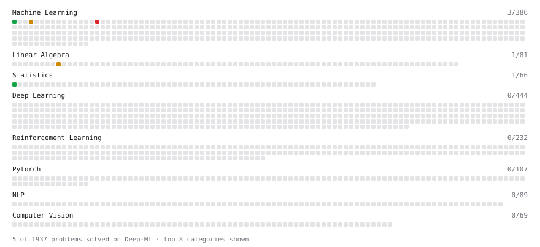

# Deep-ML

My machine learning practice from [Deep-ML](https://www.deep-ml.com). Every solution here was written by hand.

**5** solved · 5 problems · 0 labs · 0 math

[**Browse the interactive portfolio**](https://latentvoyage.github.io/deep-ml/) to replay this filling in over time.

## Problems

| | Difficulty | Solved | |
| --- | --- | --- | --- |
| [Calculate Covariance Matrix](https://www.deep-ml.com/problems/10) | easy | 2026-10-24 | [solution](problems/0010-calculate-covariance-matrix) |
| [Linear Regression Using Normal Equation](https://www.deep-ml.com/problems/14) | easy | 2026-11-06 | [solution](problems/0014-linear-regression-using-normal-equation) |
| [K-Means Clustering](https://www.deep-ml.com/problems/17) | medium | 2026-10-26 | [solution](problems/0017-k-means-clustering) |
| [Matrix times Matrix ](https://www.deep-ml.com/problems/9) | medium | 2026-10-24 | [solution](problems/0009-matrix-times-matrix) |
| [Implement AdaBoost Fit Method](https://www.deep-ml.com/problems/38) | hard | 2026-11-06 | [solution](problems/0038-implement-adaboost-fit-method) |

---

_This file is regenerated by Deep-ML on every push._
